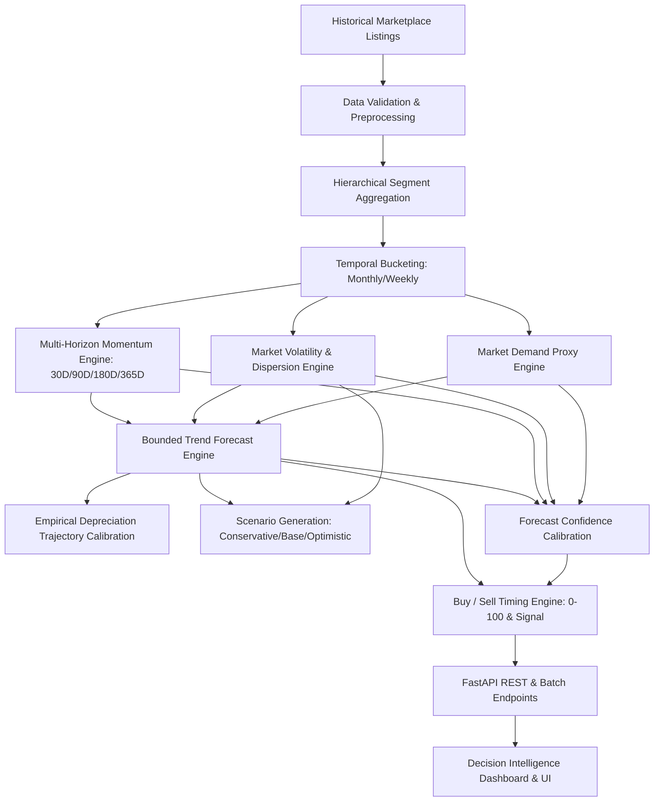

# AutoValue — Phase 14: Vehicle Market Forecasting & Buy/Sell Timing Intelligence

## 1. Executive Summary & Objective

AutoValue Phase 14 introduces a transparent, empirical temporal market forecasting and buy/sell timing decision support layer. Built directly on the verified marketplace dataset (v0.3, 999 records) and previous intelligence engines (Phases 1–13), Phase 14 provides answer to the questions:
- *Where is this vehicle market heading?*
- *Is its market price rising, stable, or declining across 30D, 90D, 180D, and 365D horizons?*
- *Is current timing favorable to buy or sell?*
- *What empirical evidence supports that conclusion, and how confident are we?*

### Critical Methodological Guarantee
The system **never manufactures forecasting certitude** or hallucinates predictions. If marketplace evidence is below calibrated thresholds (observation counts, temporal coverage, or excessive dispersion), the engine strictly returns `INSUFFICIENT_EVIDENCE` along with explicit explanations of missing evidence.

---

## 2. Core Architecture & Data Flow

---

## 3. Methodological Breakdown

### 3.1 Segment Fallback Hierarchy
To balance granularity and sample density, the engine employs a deterministic fallback hierarchy:
1. **Exact Segment**: `brand + model + variant + fuel_type + transmission + city + year`
2. **Model + Year + City**: `brand + model + year + city`
3. **Model + Year**: `brand + model + year` (national scope)
4. **Model Scope**: `brand + model` (across all model years)
5. **Brand / Family**: `brand` (broader regional context)

Every response identifies whether a fallback was applied and describes the exact hierarchy level utilized.

### 3.2 Temporal Bucketing & Data Density
- Historical observations are partitioned into monthly (or weekly for high density) temporal buckets.
- Aggregated bucket metrics include: `period_start`, `period_end`, `observation_count`, `median_price`, `p25_price`, `p75_price`, `min_price`, `max_price`, and `dispersion_cv`.
- Strict **Temporal Cutoff Enforcement**: All queries accept an optional `cutoff_date` parameter to guarantee zero future data leakage during backtesting and temporal validation.

### 3.3 Market Momentum & Trend Classification
Momentum measures the rate of change in median market price across distinct temporal windows:
$$\text{Momentum}_{\Delta t} = \frac{\text{Median}_{\text{current}} - \text{Median}_{t - \Delta t}}{\text{Median}_{t - \Delta t}}$$

- **Thresholds**:
  - `RISING`: Change > +1.5%
  - `DECLINING`: Change < -1.5%
  - `STABLE`: $-1.5\% \le \text{Change} \le +1.5\%$
  - `INSUFFICIENT_EVIDENCE`: Less than minimum observations or historical span

### 3.4 Market Volatility
Calculated using the Coefficient of Variation ($CV = \sigma / \mu$), Interquartile Range ($IQR = P_{75} - P_{25}$), and rolling standard deviation:
- `LOW`: $CV \le 0.12$
- `MODERATE`: $0.12 < CV \le 0.25$
- `HIGH`: $CV > 0.25$

### 3.5 Bounded Forecast Model & Scenarios
Forecasting uses a weighted exponential recent trend combined with bounded logarithmic extrapolation:
1. **Base Scenario**: Central expectation blending observed recent momentum and baseline segment depreciation.
2. **Conservative Scenario**: Downside-aware trajectory reflecting higher depreciation pressure and market volatility.
3. **Optimistic Scenario**: Upside-aware trajectory reflecting resilient pricing and lower downside friction.

Each forecast horizon (30D, 90D, 180D, 365D) outputs an uncertainty corridor with calibrated lower and upper bounds.

### 3.6 Buy and Sell Timing Engine
Deterministic scoring (0–100) based on observable market signals:
- **Buy Timing Components**:
  - Price discount relative to historical median ($+25$ to $-25$)
  - Price momentum stability ($+15$ for stable/cooling markets)
  - Market volatility discount ($+10$ for low volatility)
  - Demand proxy saturation ($+10$ for buyer-advantage inventory)
  - Forecast trajectory upside
- **Sell Timing Components**:
  - Price premium relative to historical median ($+25$ for peak cycle)
  - Positive market momentum ($+20$ for rising markets)
  - Expected future depreciation velocity ($+15$ to encourage selling before sharp depreciation)
  - Demand proxy strength

---

## 4. REST API Reference

| Method | Endpoint | Description | Auth / Security |
|---|---|---|---|
| `GET` | `/api/market/forecast` | Query vehicle market forecast by specs | Public / Rate Limited |
| `POST` | `/api/market/forecast` | Body-based forecast request | Public / Rate Limited |
| `GET` | `/api/market/forecast/{valuation_id}` | Forecast anchored to saved valuation | JWT Auth / IDOR / Share Token |
| `POST` | `/api/market/forecast/batch` | Batch forecast for up to 10 vehicles | Public / Rate Limited / Limit 10 |

---

## 5. Limitations & Disclaimers

1. **Marketplace Asking Prices vs Final Transaction Prices**: Observations represent advertised asking prices across marketplace portals. Actual transaction prices typically negotiate 5%–12% lower.
2. **Non-Financial Advice**: Market timing scores and forecast scenarios represent empirical decision-support indicators and do not constitute guaranteed investment, trading, or financial advice.
3. **Unforeseen Macro Factors**: Policy changes (e.g. state EV subsidies, scrappage incentives), regulatory mandates, or fuel price shocks cannot be predicted from past listing trends.
