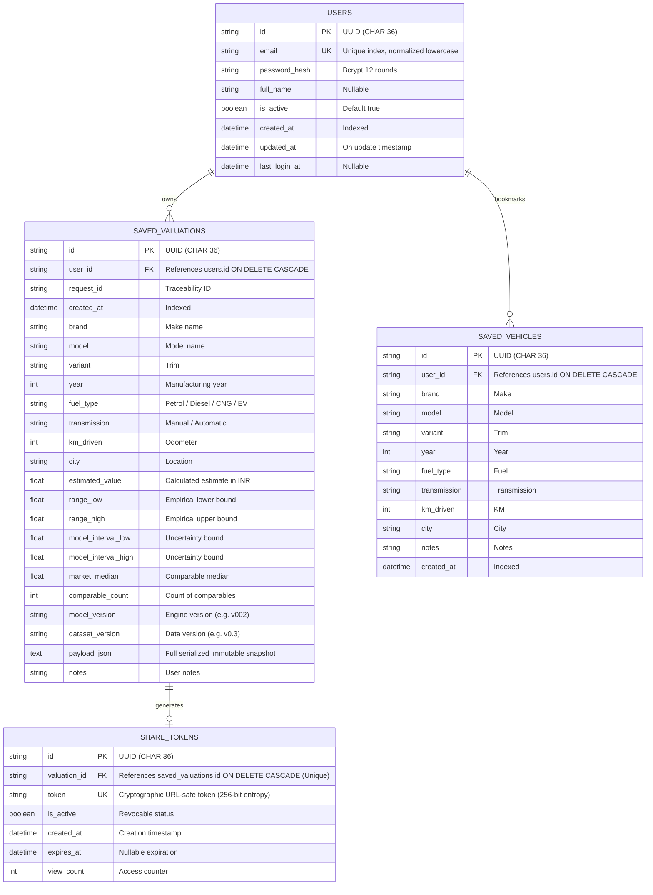

# AutoValue User Data Model & Schema (Phase 8)

## 1. Entity Relationship Overview

---

## 2. Database Constraints & Indexing Strategy
1. **Uniqueness Constraints**:
   - `users.email`: Unique index preventing duplicate registrations.
   - `saved_vehicles`: Unique fingerprint constraint `uq_user_saved_vehicle_fingerprint` across `(user_id, brand, model, variant, year, fuel_type, transmission, km_driven, city)`.
   - `share_tokens.token`: Unique index for public access.
   - `share_tokens.valuation_id`: 1:1 relationship with saved valuations.
2. **Deterministic Query Indexes**:
   - `ix_saved_valuations_user_created` (`user_id`, `created_at` DESC) to optimize history pagination and avoid N+1 scans.
   - `ix_saved_vehicles_user_created` (`user_id`, `created_at` DESC) for rapid bookmark retrieval.
   - `ix_share_tokens_token_active` (`token`, `is_active`) for fast lookup on public report pages.
